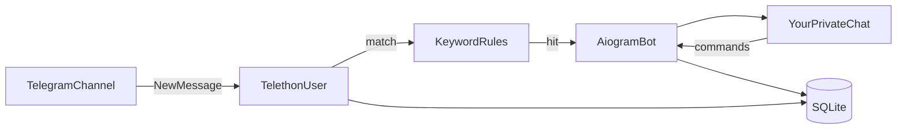
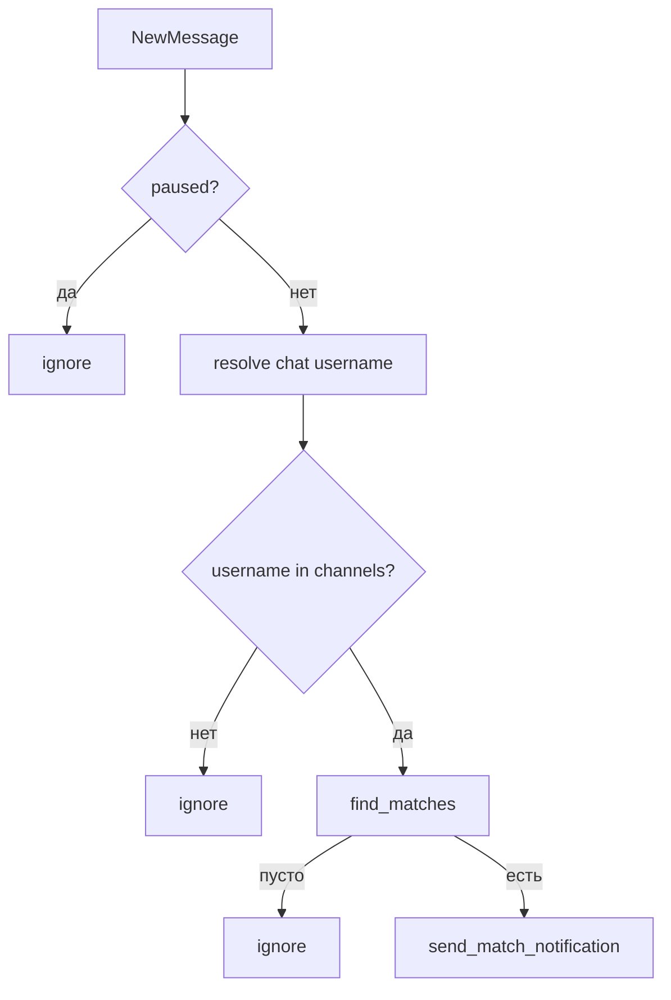
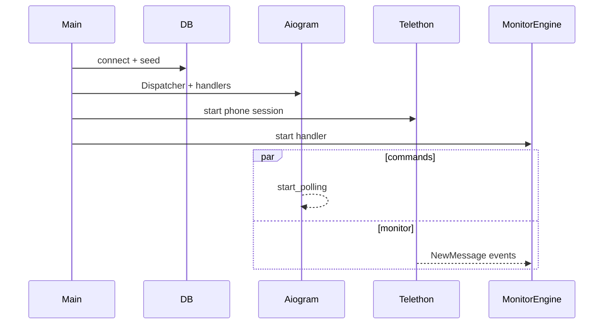

# Head First MonitorBot

Учебник-путеводитель по коду: как будто мы пишем бота **с нуля**, шаг за шагом, и в конце узнаём текущий репозиторий «в лицо».

Читать можно сверху вниз. После каждой главы — чеклист «что ты теперь понимаешь».  
Код в примерах совпадает с файлами проекта (не «как могло бы быть»).

---

## Оглавление

1. [Проблема: что мы вообще строим](#1-проблема-что-мы-вообще-строим)
2. [Smoke: один файл, который уже ловит](#2-smoke-один-файл-который-уже-ловит)
3. [Секреты: выносим ключи в `.env`](#3-секреты-выносим-ключи-в-env)
4. [Хранилище: SQLite вместо констант](#4-хранилище-sqlite-вместо-констант)
5. [Правила: Contains без регистра](#5-правила-contains-без-регистра)
6. [Движок: сердце мониторинга](#6-движок-сердце-мониторинга)
7. [Уведомления: бот пишет тебе в личку](#7-уведомления-бот-пишет-тебе-в-личку)
8. [Команды: управляем без правки кода](#8-команды-управляем-без-правки-кода)
9. [Сборка: два клиента в одном процессе](#9-сборка-два-клиента-в-одном-процессе)
10. [Карта навигации и шпаргалка](#10-карта-навигации-и-шпаргалка)

---

## 1. Проблема: что мы вообще строим

### История

Ты подписан на кучу каналов. Где-то мелькает «bitcoin», где-то «вакансия», где-то «срочно».  
Глазами не уследить. Хочется: **появилось слово → пришло уведомление**.

### Наивная идея №1: «просто бот»

Берём Bot API. Бот сидит в канале и читает посты.

**Почему ломается:** бот видит посты канала только если он **админ** этого канала.  
Для чужих публичных/приватных каналов, куда ты просто подписан как человек, — мимо.

### Наивная идея №2: «парсить t.me/s/»

**Почему ломается:** только публичные, с задержкой, HTML может поменяться завтра.

### Рабочая идея: гибрид

| Роль | Кто | Зачем |
|------|-----|--------|
| Слушатель | **User-сессия** (Telethon, MTProto) | Видит каналы, куда вступил твой аккаунт |
| Голос | **Бот** (aiogram, Bot API) | Команды и пуш в личку |

Запомни картинку:



### Что ты теперь понимаешь

- [ ] MonitorBot = не «ещё один CRUD-бот», а **монитор + нотификатор**
- [ ] Чистый Bot API для чужих каналов не подходит
- [ ] В проекте два Telegram-клиента с разными задачами

---

## 2. Smoke: один файл, который уже ловит

Прежде чем городить `app/`, мы проверяем гипотезу одним скриптом.

**Открой:** [`smoke_test.py`](../smoke_test.py)

### Что внутри (ментальная модель)

1. Константы: `API_ID`, `API_HASH`, `PHONE`, `BOT_TOKEN`, `NOTIFY_CHAT_ID`, списки каналов/ключей.
2. `TelegramClient` — «я как пользователь».
3. `Bot` — «я как бот».
4. `match()` — есть ли любое ключевое слово в тексте.
5. На `NewMessage` — если match → `bot.send_message(...)`.
6. `FloodWaitError` — Telegram сказал «подожди N секунд» → спим.

Ключевые строки:

```python
user = TelegramClient("session", API_ID, API_HASH)
bot = Bot(token=BOT_TOKEN)

@user.on(events.NewMessage)
async def handler(event):
    if not match(event.raw_text):
        return
    await bot.send_message(NOTIFY_CHAT_ID, text)
```

### Попробуй так подумать

Smoke **не** умеет:

- менять ключи командой;
- паузу;
- переживать рестарт с нормальной БД;
- фильтровать только выбранные каналы аккуратно (в smoke матч по всем сообщениям сессии, без жёсткого фильтра списка — смотри логику: там нет проверки `CHANNELS`!).

Стоп. Перечитай `handler`: в smoke **нет** фильтра по `CHANNELS`.  
Список `CHANNELS` объявлен… и не используется. Это учебный «черновик идеи», не финальный продукт.

В настоящем движке (`MonitorEngine`) фильтр каналов **есть**. Smoke отвечает на вопрос: «Telethon + aiogram вообще дружат?»

### Запуск (когда будут реальные ключи)

```bash
python smoke_test.py
```

Первый раз Telethon попросит код из SMS/приложения и сохранит `.session`.

### Что ты теперь понимаешь

- [ ] Happy path мониторинга умещается в ~50 строк
- [ ] Smoke — доказательство стека, не архитектура
- [ ] `FloodWait` — не баг, а контракт Telegram

---

## 3. Секреты: выносим ключи в `.env`

Хардкод в `smoke_test.py` удобен на 5 минут и опасен навсегда (токены в git — боль).

**Открой:** [`app/config.py`](../app/config.py), [`.env.example`](../.env.example)

### Как мы это «изобретаем»

1. Кладём значения в `.env`.
2. При старте читаем через `python-dotenv`.
3. Собираем неизменяемый `Settings` (dataclass `frozen=True`).
4. Если чего-то нет — сразу `ValueError`, а не падение где-то в Telethon.

Идея `load_settings()`:

```text
.env → строки → проверка обязательных → int/path → Settings
```

Ещё: `CHANNELS` и `KEYWORDS` из env — **семена** для пустой БД (см. главу 4), не единственный источник правды после запуска.

### Что ты теперь понимаешь

- [ ] Секреты только в `.env` (файл в `.gitignore`)
- [ ] `Settings` — единая точка конфигурации для `main`
- [ ] Пути `sessions/` и `data/` создаются при загрузке настроек

---

## 4. Хранилище: SQLite вместо констант

Хотим `/add_keyword bitcoin` без перезапуска и без правки файла.

**Открой:** [`app/database.py`](../app/database.py)

### Три таблицы — три идеи

| Таблица | Смысл |
|--------|--------|
| `keywords` | Что ищем |
| `channels` | Где ищем (username без `@`) |
| `settings` | Сейчас важно: `paused` = `0`/`1` |

### API, которым пользуются остальные модули

- `add_keyword` / `delete_keyword` / `list_keywords`
- `add_channel` / `delete_channel` / `list_channels`
- `is_paused` / `set_paused`
- `seed_if_empty` — если таблицы пустые, взять семена из `.env`

### Мелочь, которая спасает нервы

`normalize_channel("https://t.me/durov")` → `"durov"`.  
Одна функция — один способ писать username в БД и в ответах бота.

### Что ты теперь понимаешь

- [ ] После первого запуска источник правды — SQLite, не константы
- [ ] Пауза — просто флаг в `settings`, движок его читает
- [ ] `IntegrityError` на UNIQUE = «уже есть» → `False`, без падения

---

## 5. Правила: Contains без регистра

Пока MVP: **подстрока**, без regex, без exact.

**Открой:** [`app/monitor/rules.py`](../app/monitor/rules.py)

```python
def find_matches(text, keywords) -> list[str]:
    # "Hello Bitcoin" + ["bitcoin"] → ["bitcoin"]
```

Почему отдельный файл?

- Движок не должен знать *как* матчим.
- Завтра добавим Exact/Regex — поменяем rules, не Telethon-обвязку.

### Что ты теперь понимаешь

- [ ] Matching — чистая функция без I/O
- [ ] Регистр игнорируется
- [ ] Возвращается **список совпавших слов** (удобно показать в уведомлении)

---

## 6. Движок: сердце мониторинга

**Открой:** [`app/monitor/engine.py`](../app/monitor/engine.py)

### Роль класса `MonitorEngine`

Связывает:

- Telethon (`client`) — откуда события;
- БД — каналы, ключи, pause;
- aiogram Bot — куда слать hit.

### Конвейер одного сообщения

Читай `_on_new_message` как конвейер с early return:



Куски кода названы по шагам:

| Метод | Зачем |
|-------|--------|
| `_resolve_chat` | username + человекочитаемое имя |
| `_is_watched` | только каналы из БД; без username — не матчим |
| `_public_message_link` | ссылка `t.me/name/id` |

`start()` вешает handler на `events.NewMessage`.  
`stop()` снимает его (аккуратно при shutdown).

### Ошибки

- `FloodWaitError` → sleep `exc.seconds`
- Остальное → `logger.exception`, процесс живёт дальше

### Что ты теперь понимаешь

- [ ] Движок = оркестратор, не «бог всего»
- [ ] Порядок фильтров важен: сначала дешёвые отсечения
- [ ] Каналы без `@username` в MVP не попадают в watched

---

## 7. Уведомления: бот пишет тебе в личку

**Открой:** [`app/bot/notifications.py`](../app/bot/notifications.py)

Одна задача: собрать текст и `send_message`.

Формат:

```text
🔔 Совпадение в @channel

превью текста (до 500)

Ключи: bitcoin, тест
https://t.me/channel/123
```

Если Bot API ответил «подожди» (`TelegramRetryAfter`) — sleep и повтор один раз.

Движок **не** форматирует сообщение сам — меньше связности.

### Что ты теперь понимаешь

- [ ] Уведомление = отдельный слой
- [ ] RetryAfter у бота ≠ FloodWait у Telethon (разные API, похожий смысл)

---

## 8. Команды: управляем без правки кода

**Открой:** [`app/bot/handlers.py`](../app/bot/handlers.py)

### Почему класс `BotCommands`

Раньше handlers жили вложенными функциями внутри `setup_handlers` — читать больно.  
Сейчас:

1. `BotCommands(db)` хранит доступ к БД.
2. `build_router(admin_id)` регистрирует команды явно.
3. Фильтр `F.chat.id == admin_id` — чужие люди боту не указ.

`setup_handlers(db, admin_id)` — тонкий вход для `main`.

### Карта команд → БД

| Команда | Эффект |
|---------|--------|
| `/add_keyword` | `db.add_keyword` |
| `/del_keyword` | `db.delete_keyword` |
| `/keywords` | список |
| `/add_channel` | `db.add_channel` (+ normalize) |
| `/del_channel` | `db.delete_channel` |
| `/channels` | список |
| `/pause` / `/resume` | `set_paused` |
| `/status` | pause + счётчики |

Тексты ответов на русском — так задумано в ТЗ.

### Что ты теперь понимаешь

- [ ] Команды меняют БД; движок читает БД на каждом сообщении
- [ ] Админ = `NOTIFY_CHAT_ID`
- [ ] Новый command handler = метод + одна строка `register`

---

## 9. Сборка: два клиента в одном процессе

**Открой:** [`app/main.py`](../app/main.py)

### Сценарий старта (вслух)

1. `load_settings()` — без `.env` дальше не идём.
2. `_open_database` — connect + seed.
3. `_build_bot` — Bot + Dispatcher + router команд.
4. `_start_telethon` — логин user-сессии (файл в `sessions/`).
5. `MonitorEngine.start()` — подписка на `NewMessage`.
6. `asyncio.gather(polling, run_until_disconnected)` — **оба цикла сразу**.
7. При выходе — `_shutdown`: снять handler, закрыть БД, бота, Telethon.



Точка входа:

```bash
python -m app.main
```

### Что ты теперь понимаешь

- [ ] Один процесс, два async-цикла
- [ ] Порядок инициализации: настройки → БД → бот → user → engine → gather
- [ ] `finally` гарантирует аккуратное выключение

---

## 10. Карта навигации и шпаргалка

### Где править X

| Хочу… | Файл |
|-------|------|
| Добавить тип матчинга | `app/monitor/rules.py` |
| Изменить фильтр каналов / pipeline | `app/monitor/engine.py` |
| Текст пуша | `app/bot/notifications.py` |
| Новую команду | `app/bot/handlers.py` |
| Поле в `.env` | `app/config.py` + `.env.example` |
| Таблицу / CRUD | `app/database.py` |
| Порядок старта | `app/main.py` |
| Быстро проверить стек | `smoke_test.py` |
| Продуктовые требования | `TZ-telegram-monitor-bot.md` |

### Дерево проекта (MVP)

```text
monitor-bot/
├── app/
│   ├── main.py              ← сборка
│   ├── config.py            ← .env → Settings
│   ├── database.py          ← SQLite
│   ├── monitor/
│   │   ├── engine.py        ← NewMessage pipeline
│   │   └── rules.py         ← Contains
│   └── bot/
│       ├── handlers.py      ← команды
│       └── notifications.py ← пуш
├── sessions/                ← Telethon session (не в git)
├── data/                    ← monitor.db (не в git)
├── smoke_test.py
├── .env.example
├── requirements.txt
└── docs/HEAD_FIRST_MONITORBOT.md  ← ты здесь
```

### Шпаргалка запуска

```bash
python -m venv .venv
.venv\Scripts\activate
pip install -r requirements.txt
copy .env.example .env
# заполни .env
python -m app.main
```

В Telegram: напиши боту `/start`, добавь канал и ключ, дождись поста с ключом.

### Как читать код в первый день (30 минут)

1. Этот учебник, главы 1–2.  
2. `smoke_test.py` целиком.  
3. `engine._on_new_message` + `rules.find_matches`.  
4. `main.run` сверху вниз.  
5. Одну команду в `BotCommands` (например `cmd_add_keyword`) и её путь в `Database`.

### Финальный чеклист

- [ ] Могу объяснить, зачем Telethon и зачем aiogram
- [ ] Могу пройти пальцем путь: пост → match → личка
- [ ] Знаю, где лежат секреты, сессия и БД
- [ ] Знаю, чем smoke отличается от `app/`

---

*Дальше по ТЗ: антидубли, `/history`, reconnect, Exact/Regex, Docker, потом Java-портфолио. Но это уже следующие книги — сначала уверенно читай MVP.*
